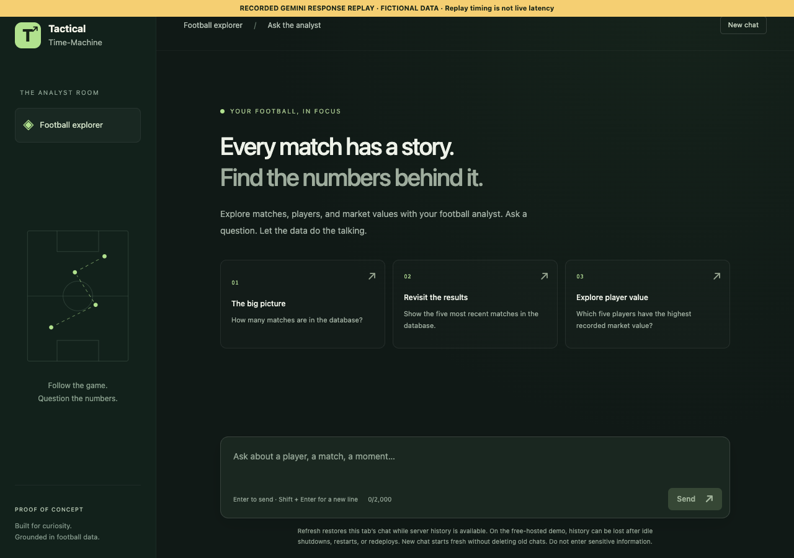
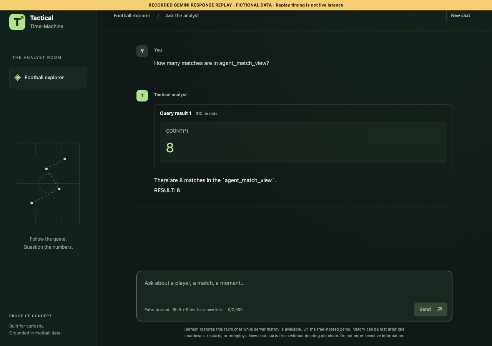

# Recorded demonstration

[Watch the short WebM recording](media/demo.webm)




This is the actual React application rendering **captured live Gemini responses**
from the [October 15 evaluation](evaluation/live-2026-10-15.json). Playwright
intercepts the API request and replays the saved event transcript. The label is
visible throughout. Replay timing is artificial, not measured streaming latency.
The match count (8) and club count (4) are from fictional data, not real clubs.
The questions were evaluated independently; this replay does not demonstrate
conversational memory or a live end-to-end network session.

This reliable recording needs no hosted service or API quota. To try live
end-to-end operation with your own model key, follow the root README quickstart.

## Regenerate the recording

```bash
cd frontend
npm ci
npx playwright install chromium
node scripts/record-demo.mjs
```

Alternatively set `PLAYWRIGHT_CHANNEL=chrome` to use installed Chrome (Playwright's
video encoder must also be installed). The script starts a temporary local Vite
server on port 5175, makes no Gemini calls, and rewrites the three media artifacts.
It does not publish the recording or deploy the application.
